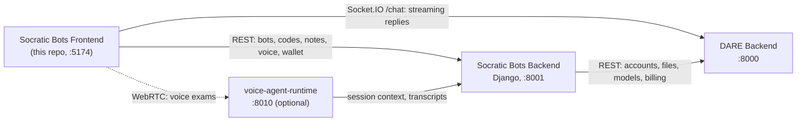

# Socratic Bots Frontend

[](LICENSE)
[](https://nodejs.org/)

> The React web app for **Socratic Bots**: AI tutors that guide students with questions instead of
> handing them answers. Built on [DARE](https://github.com/cmudco/dare-backend).

## What is Socratic Bots?

Socratic Bots lets instructors build AI tutors for a course. An instructor writes the tutor's
teaching instructions, attaches course documents, picks a model, and shares the tutor with students
through access codes or a public link. Students chat with the tutor, keep notes, and can take spoken
exams with a voice agent. The tutor asks guiding questions rather than giving away answers, and can
track each student's progress against learning goals.

Socratic Bots is a layer on top of DARE. Accounts, LLM chat, document ingestion and retrieval, and
billing live in the DARE backend; Socratic Bots adds tutors, bot groups, access codes, notes, and
voice exams.

**This repository is the browser app.** It talks to three services:

- **REST** goes to the Socratic Bots backend only (`VITE_API_URL`).
- **Chat** connects straight to DARE's Socket.IO `/chat` namespace (`VITE_DARE_SOCKET_URL`). DARE
  runs the model, retrieval, and tools, and bills the chat.
- **Voice exams** connect straight to the voice runtime over WebRTC, using a URL the Socratic Bots
  backend signs for each session.

> **Requires DARE.** Socratic Bots does not run on its own. You need a running
> [DARE backend](https://github.com/cmudco/dare-backend) and the
> [Socratic Bots backend](https://github.com/cmudco/socraticbots-backend). The reverse is not true:
> DARE is a complete product without Socratic Bots.

## Overview



The app owns no data: it reads and writes everything through the services above. See
[docs/explanation/architecture.md](docs/explanation/architecture.md) for the full picture.

## Features

- **Tutor builder.** Bot groups and bots with teaching instructions, subject and topic, model choice
  (DARE models or LiteLLM gateway models), attached course files, retrieval mode (fast, thorough, or
  autonomous document search), web search, history limits, themes, quick prompts, and collaborators.
- **Progress tracking.** Optional per-bot tracker that scores the conversation against learning
  goals.
- **Sharing.** Bot access codes for students, a user list per bot, and public deployment links for
  anonymous chat.
- **Chat.** Streaming replies, stop generation, image attachments, tool activity, a notes panel,
  PDF export, and a message-details drawer for creators (retrieval trace, sources, tokens, cost).
- **Voice exams.** Voice agents with teams, members, and retakes; live spoken sessions over WebRTC
  (Mistral/Pipecat runtime) or ElevenLabs; transcripts and PDF export; a speech-to-text lab and
  browser diagnostics.
- **Wallet.** Wallet balance, transactions, provider API keys, LiteLLM keys, and per-bot usage, all
  backed by DARE billing.

Building and managing tutors requires a creator role in DARE. Students redeem codes, chat, keep notes,
and take voice exams.

## Quick start

Requires Node.js 20+ (or Docker) and a running Socratic Bots backend on `:8001` with DARE on `:8000`. If you
don't have those yet, follow the
[full-stack quick start](https://github.com/cmudco/socraticbots-backend/blob/dev/docs/tutorials/quickstart.md)
first.

```bash
git clone https://github.com/cmudco/socraticbots-frontend.git
cd socraticbots-frontend
npm ci
cp .env.example .env
npm run dev -- --port 5174
```

Or serve the production build with Docker, without Node:

```bash
docker build -t socraticbots-frontend .
docker run -d -p 5174:80 socraticbots-frontend
```

The app runs at <http://localhost:5174>. Step-by-step setup, every script, and troubleshooting are
in [docs/tutorials/quickstart.md](docs/tutorials/quickstart.md).

## Documentation

| Kind        | Doc                                                                  | What's in it                                               |
| ----------- | -------------------------------------------------------------------- | ---------------------------------------------------------- |
| Tutorial    | [docs/tutorials/quickstart.md](docs/tutorials/quickstart.md)         | Run the frontend locally, verify it, fix common problems   |
| How-to      | [docs/how-to/deploy.md](docs/how-to/deploy.md)                       | Build and serve the app in production                      |
| How-to      | [tests/README.md](tests/README.md)                                   | Unit tests, voice contract tests, manual chat regressions  |
| Reference   | [docs/reference/configuration.md](docs/reference/configuration.md)   | Every environment variable                                 |
| Reference   | [tests/SOCKET_CONTRACT.md](tests/SOCKET_CONTRACT.md)                 | The chat Socket.IO wire contract shared with DARE          |
| Explanation | [docs/explanation/architecture.md](docs/explanation/architecture.md) | How the app is structured and how it talks to each service |
| Project     | [.github/CONTRIBUTING.md](.github/CONTRIBUTING.md)                   | Issues, pull requests, checks to run                       |
| Project     | [docs/reference/rules.md](docs/reference/rules.md)                   | Frontend coding rules                                      |
| Project     | [.github/SECURITY.md](.github/SECURITY.md)                           | Reporting vulnerabilities, hardening notes                 |
| Project     | [AGENTS.md](AGENTS.md)                                               | Guide for AI coding agents working in this repo            |
| Project     | [BRAND.md](BRAND.md)                                                 | Brand and trademark usage policy                           |

## Tech stack

- React 19, TypeScript 5.7, Vite 6
- React Router 7
- TanStack Query 5 (server state) and Zustand 5 (client state)
- Tailwind CSS 4 with the typography plugin, shadcn/ui on Radix primitives, lucide icons
- socket.io-client 4 for chat
- react-markdown with GFM, KaTeX math, and syntax highlighting
- React Hook Form + Zod and Formik + Yup (both are in use)
- `@elevenlabs/react` and a WebRTC client for the Pipecat voice runtime
- Sentry for error reporting (optional)
- Vitest + Testing Library, ESLint, Prettier, Husky + lint-staged

## What is included in this repo?

- `src/`: the app (`pages/`, `components/`, `hooks/`, `services/` for REST, `stores/` for Zustand,
  `config/socket.config.ts` for chat, `lib/`, `types/`, `utils/`, `themes/`)
- `tests/`: Vitest suites plus browser-console regression scripts for chat
- Build and quality config: Vite, TypeScript, ESLint, Prettier, Husky
- Agent config: `AGENTS.md`, `.claude/CLAUDE.md`, `.agents/skills/`

## What is not included in this repo?

- [socraticbots-backend](https://github.com/cmudco/socraticbots-backend): the Django API this app
  calls for everything except chat and voice media (required)
- [dare-backend](https://github.com/cmudco/dare-backend): accounts, LLM chat, files, retrieval, and
  billing (required)
- [voice-agent-runtime](https://github.com/cmudco/voice-agent-runtime): the Pipecat voice runtime for
  spoken exams (optional)
- [dare-frontend](https://github.com/cmudco/dare-frontend): DARE's own web app, used only for
  hand-off links such as billing (optional)

## Stay in touch

- **Found a bug or want a feature?** Open an issue in this repository.
- **Found a security issue?** Report it privately as described in [.github/SECURITY.md](.github/SECURITY.md).
- **Questions or general inquiries?** Email the project team at vks@andrew.cmu.edu.

## Acknowledgements

Socratic Bots is developed at the Dietrich College of Humanities and Social Sciences, Carnegie Mellon
University, and is built on the [DARE](https://github.com/cmudco/dare-backend) platform.

"DARE" (Dietrich Analysis Research Education Platform) and "SocraticBots" are trademarks of Carnegie
Mellon University; see [BRAND.md](BRAND.md) for the usage policy. Send trademark and licensing
questions to vks@andrew.cmu.edu.

The app integrates with third-party APIs (for example Anthropic, OpenAI, Google, Mistral, and
ElevenLabs), each subject to its provider's terms of service.

## Contributors

Socratic Bots is built and maintained by the team at the Dietrich College of Humanities and Social
Sciences, Carnegie Mellon University.

**Creators**

<table>
  <tr>
    <td align="center" valign="top" width="33.33%"><br /><sub><b>Sayeed Choudhury</b></sub><br />Creator</td>
    <td align="center" valign="top" width="33.33%"><br /><sub><b>Vincent Sha</b></sub><br />Creator</td>
    <td align="center" valign="top" width="33.33%"><br /><sub><b>George Cann</b></sub><br />Creator</td>
  </tr>
</table>

**Team**

<table>
  <tr>
    <td align="center" valign="top" width="33.33%"><br /><sub><b>Carl Skipper</b></sub><br />Contributor</td>
    <td align="center" valign="top" width="33.33%"><br /><sub><b>Muhammad Abdurrehman</b></sub><br />Team Lead</td>
    <td align="center" valign="top" width="33.33%"><br /><sub><b>Brian Wingenroth</b></sub><br />Developer</td>
  </tr>
  <tr>
    <td align="center" valign="top" width="33.33%"><br /><sub><b>Farhat Abbas</b></sub><br />Developer</td>
    <td align="center" valign="top" width="33.33%"><br /><sub><b>Hariss M.</b></sub><br />Developer</td>
    <td align="center" valign="top" width="33.33%"><br /><sub><b>Eira Khan</b></sub><br />QA</td>
  </tr>
</table>

## License

This project is licensed under the [GNU Affero General Public License v3.0](LICENSE)
(AGPL-3.0-only). © 2024–2026 Carnegie Mellon University. The full text is in [LICENSE](LICENSE) and
at <https://www.gnu.org/licenses/agpl-3.0.en.html>.
