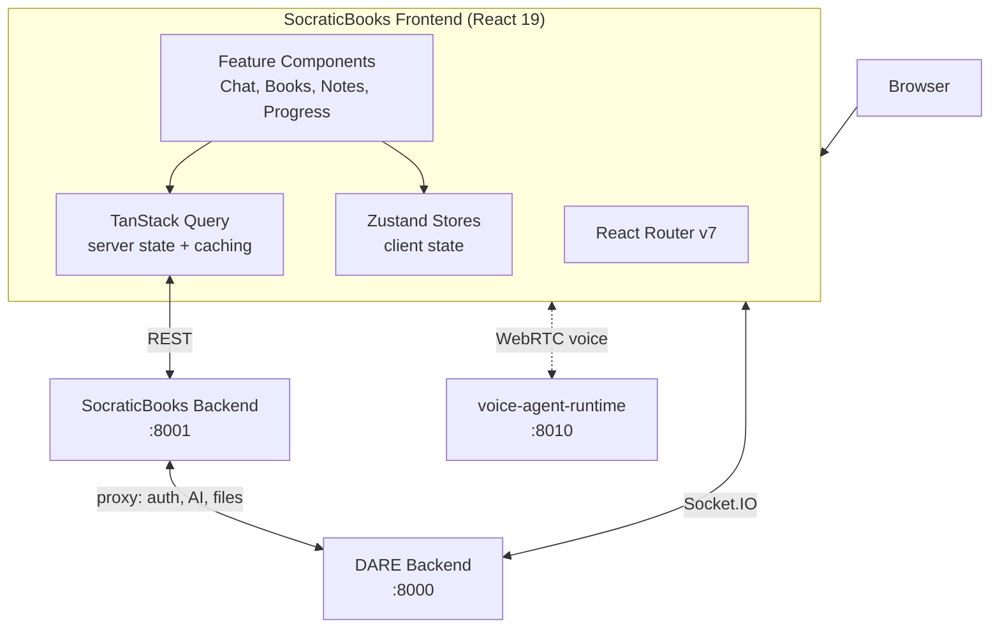

# SocraticBooks Frontend

[](LICENSE)
[](https://nodejs.org/)

> React/TypeScript frontend for **SocraticBooks** — an AI Socratic-tutoring platform built on DARE.

## Table of Contents

- [What is SocraticBooks?](#what-is-socraticbooks)
- [Overview](#overview)
- [Quick Start](#quick-start)
- [Documentation](#documentation)
- [Tech Stack](#tech-stack)
- [What is included in this repo?](#what-is-included-in-this-repo)
- [What is not included in this repo?](#what-is-not-included-in-this-repo)
- [Stay in touch](#stay-in-touch)
- [Acknowledgements](#acknowledgements)
- [Contributors](#contributors)
- [License](#license)

## What is SocraticBooks?

SocraticBooks (also referred to as Socratic Bots) is an open-source, AI-powered educational platform
built on top of [DARE](https://github.com/cmudco/dare-backend). It pairs structured learning content — books,
chapters, and notes — with conversational AI tutors that use the Socratic method to guide students
toward understanding rather than handing them answers. SocraticBooks delegates authentication, LLM
access, and file processing to DARE, and adds the educational layer on top: progress tracking,
access-code enrollment, and bot/tutor configuration.

**This repository is the SocraticBooks web frontend** — the student- and instructor-facing React app.
It talks to the [SocraticBooks backend](https://github.com/cmudco/socraticbots-backend) for all platform data and
connects to the DARE backend over Socket.IO for real-time chat. Features include:

- **Socratic chat** — real-time, streaming dialogue with AI tutors
- **Books & chapters** — structured learning content with note-taking and annotations
- **Rich text editing** — a TipTap-based editor for chat and notes (Markdown, math, code)
- **Progress tracking** — AI-assisted assessment of student understanding
- **Voice tutoring** — optional spoken sessions via the separate voice-agent-runtime

> **Requires DARE.** SocraticBooks runs on top of DARE. To use it you must also have the
> [DARE backend](https://github.com/cmudco/dare-backend) running (and the SocraticBooks backend in front of it),
> because authentication, LLM access, and file processing all come from DARE. The reverse is not true:
> DARE runs standalone and does not require SocraticBooks.

## Overview



Client state lives in Zustand stores; server state is fetched and cached with TanStack Query against
the SocraticBooks backend. Real-time chat streams from DARE over Socket.IO, and optional voice
sessions are negotiated with the standalone voice runtime.

## Quick Start

**Prerequisites:** Node.js 18+, a running [SocraticBooks backend](https://github.com/cmudco/socraticbots-backend)
(default `http://localhost:8001`), and the [DARE backend](https://github.com/cmudco/dare-backend) it proxies to
(default `http://localhost:8000`).

```bash
# 1. Install dependencies
npm install

# 2. Configure environment
cp .env.example .env.local
# VITE_API_URL          -> SocraticBooks backend API (default http://localhost:8001/api)
# VITE_DARE_SOCKET_URL  -> DARE backend for Socket.IO (default http://localhost:8000)
# VITE_DARE_FRONTEND_URL -> DARE web app for cross-links (default http://localhost:5173)

# 3. Run the dev server on port 5174 (DARE frontend holds 5173)
npm run dev -- --port 5174
```

Then open http://localhost:5174. The dev server hot-reloads on changes.

For a production build:

```bash
npm run build       # type-checks then produces ./dist
npm run preview     # serves ./dist locally for verification
```

### Available scripts

| Command                | Description                         |
| ---------------------- | ----------------------------------- |
| `npm run dev`          | Start the Vite dev server           |
| `npm run build`        | Type-check and produce `dist/`      |
| `npm run preview`      | Serve the production bundle locally |
| `npm run lint`         | Run ESLint                          |
| `npm run lint:fix`     | Run ESLint with autofix             |
| `npm run format`       | Run Prettier                        |
| `npm run format:check` | Check formatting                    |

## Documentation

| Doc                    | What's in it                                           |
| ---------------------- | ------------------------------------------------------ |
| [CLAUDE.md](CLAUDE.md) | Architecture, state management, and component patterns |
| [rules.md](rules.md)   | Frontend coding standards and conventions              |
| [CONTRIBUTING.md](CONTRIBUTING.md) | Contribution and validation checklist |
| [SECURITY.md](SECURITY.md) | Private reporting and configuration guidance |
| [CHANGELOG.md](CHANGELOG.md) | Unreleased onboarding changes |
| [BRAND.md](BRAND.md)   | Brand and trademark usage policy                       |

## Tech Stack

- **React 19** + **TypeScript**
- **Vite 6** for build and dev server
- **Zustand** for client state
- **TanStack Query** for server state and caching
- **React Router v7**
- **Tailwind CSS v4** + **Radix UI** primitives
- **TipTap** rich text editor
- **React Hook Form + Zod** for forms and validation
- **socket.io-client** for real-time chat
- **ElevenLabs React SDK** for voice support

## What is included in this repo?

- `src/` — application source: `components/`, `pages/`, `hooks/`, `services/` (API layer),
  `stores/` (Zustand), `types/`, `utils/`, and `lib/`
- Build and quality config — Vite, Tailwind, ESLint, Prettier, Husky
- Project docs — `CLAUDE.md`, `rules.md`, `BRAND.md`

## What is not included in this repo?

- [socraticbooks-backend](https://github.com/cmudco/socraticbots-backend) — the Django API this app depends on (run it separately)
- [dare-backend](https://github.com/cmudco/dare-backend) — the DARE backend that SocraticBooks proxies for auth, AI, and files
- [voice-agent-runtime](https://github.com/cmudco/voice-agent-runtime) — the standalone Pipecat/WebRTC voice runtime used for spoken tutoring

## Stay in touch

- **Found a bug or have a feature request?** Open an issue on the project's GitHub repository.
- **Questions or general inquiries?** Email the project team at vks@andrew.cmu.edu.

## Acknowledgements

SocraticBooks is developed at the Dietrich College of Humanities and Social Sciences, Carnegie Mellon
University, and is built on the [DARE](https://github.com/cmudco/dare-backend) platform.

"DARE" (Dietrich Analysis Research Education Platform) and "SocraticBots" are trademarks of Carnegie
Mellon University. See [BRAND.md](BRAND.md) for the brand usage policy. For trademark, licensing, or
general inquiries, contact the project team at vks@andrew.cmu.edu.

This software integrates with third-party APIs (Anthropic, OpenAI, ElevenLabs, and others); use of
those APIs is subject to each provider's own Terms of Service.

## Contributors

SocraticBooks is built and maintained by the team at the Dietrich College of Humanities and Social
Sciences, Carnegie Mellon University.

**Creators**

<table>
  <tr>
    <td align="center" valign="top" width="33.33%"><br /><sub><b>Sayeed Choudhury</b></sub><br />Creator</td>
    <td align="center" valign="top" width="33.33%"><br /><sub><b>Vincent Sha</b></sub><br />Creator</td>
    <td align="center" valign="top" width="33.33%"><br /><sub><b>George Cann</b></sub><br />Creator</td>
  </tr>
</table>

**Team**

<table>
  <tr>
    <td align="center" valign="top" width="33.33%"><br /><sub><b>Carl Skipper</b></sub><br />Contributor</td>
    <td align="center" valign="top" width="33.33%"><br /><sub><b>Muhammad Abdurrehman</b></sub><br />Team Lead</td>
    <td align="center" valign="top" width="33.33%"><br /><sub><b>Brian Wingenroth</b></sub><br />Developer</td>
  </tr>
  <tr>
    <td align="center" valign="top" width="33.33%"><br /><sub><b>Farhat Abbas</b></sub><br />Developer</td>
    <td align="center" valign="top" width="33.33%"><br /><sub><b>Hariss M.</b></sub><br />Developer</td>
    <td align="center" valign="top" width="33.33%"><br /><sub><b>Eira Khan</b></sub><br />QA</td>
  </tr>
</table>

## License

This project is licensed under the [GNU Affero General Public License v3.0](LICENSE) (AGPL-3.0-only).

See the [LICENSE](LICENSE) file for the full license text, or visit <https://www.gnu.org/licenses/agpl-3.0.en.html>.
